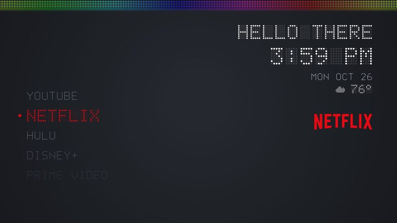
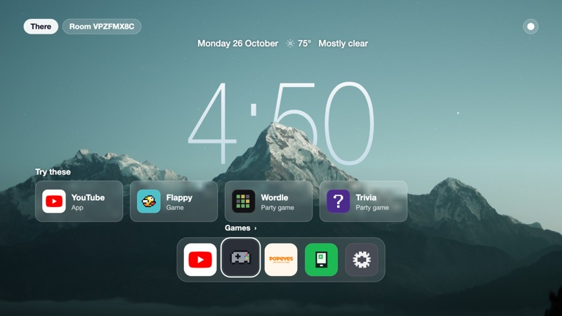
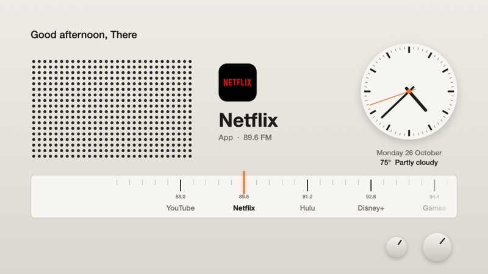
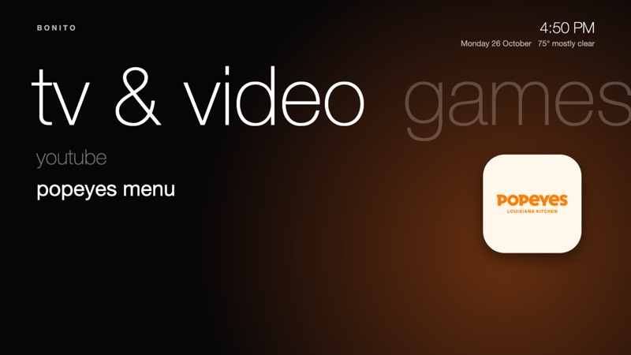
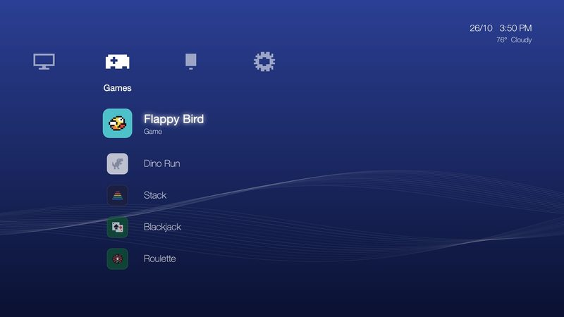

# Bonito

A home screen for the whole room: arcade and party games, your phone as the remote, and a
Spotify queue your friends can add to. Free and open source, for Samsung, Google TV,
Android TV, Fire TV and any TV with a browser.

**[Try it, watch the games play and install it at jbw9.github.io/bonito-tv](https://jbw9.github.io/bonito-tv/)**

## Five looks

Pick one when you install and switch any time in Settings.

| | |
| --- | --- |
|  **Horizon**, inspired by [@joshuaseage](https://www.instagram.com/joshuaseage/) |  **Dial**, after Dieter Rams' radios for Braun |
|  **Panorama**, after the Zune HD |  **Media bar** |

Bonito itself is inspired by [@tyler_](https://www.instagram.com/tyler_/).

## Install

The [website](https://jbw9.github.io/bonito-tv/#install) walks you through it for your TV.
With Claude Code, point it at [SETUP.md](SETUP.md) and it does the install for you. Every
step in detail, settings and fixes are in [the full guide](docs/guide.md).

## License

MIT. See [LICENSE](LICENSE).
